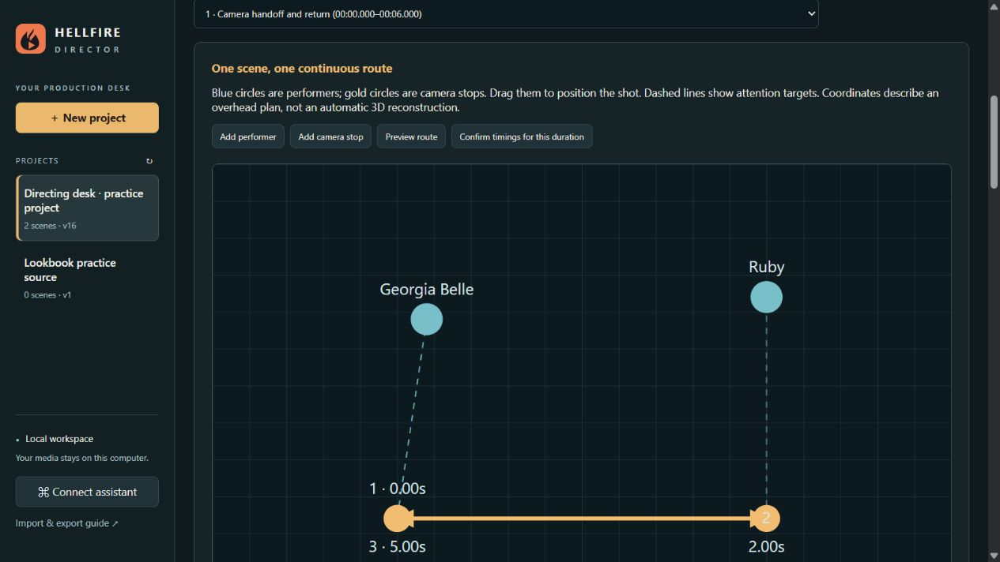

# AI Music Video Planner

**Plan your music video. Give your AI agent a clear production plan.**

Plan your music video scene by scene with lyrics, timing, character references, camera movements, lighting and creative direction. Export a structured production package for your AI agent or preferred AI tools to turn your vision into a finished music video.

The application interface is called **Hellfire Director**. It runs locally in your browser, saves projects on your computer and works without an account. Windows with Python 3.12 is the tested setup.



*Example: plan one camera move from the singer to another performer and back. The screenshot uses a separate practice project.*

## How the planner and your agent work together

1. **You direct:** load your song, write the story and lyrics, choose the visual approach, and plan each scene.
2. **You hand off:** export the project ZIP, or connect an assistant running on the same computer through the included CLI or stdio MCP bridge.
3. **Your agent produces:** use your chosen image, video, lip-sync and editing tools to create the assets and assemble the video, following your model choices and budget approvals.
4. **You review:** bring the finished cut and alternate takes back into the planner, compare versions, leave exact-frame notes, and track repairs.

The planner organizes production; it does not contain built-in paid generation integrations or render the final video itself. Cloud-only assistants can use exported files if they support those file types; the local assistant bridge requires access to the computer running the app. See the [agent handoff guide](docs/AGENT_HANDOFF.md).

## Run on Windows

1. Install **Python 3.12** from [python.org](https://www.python.org/downloads/). Include the Python launcher / PATH option.
2. Choose **Code → Download ZIP** on GitHub and extract it to a permanent folder, or run `git clone https://github.com/bigchez2143/AIMusicVideoPlanner.git`.
3. Double-click **Setup.cmd**. It creates an isolated Python environment, installs dependencies, and adds an **AI Music Video Timeline** desktop shortcut.
4. Open the desktop shortcut. A local app opens in your browser at `http://127.0.0.1:47831`.

Keep the installation folder in place: the shortcut points to it. The server continues running when the browser tab closes. Relaunching the shortcut reopens the app. Restart Windows or stop that Python process to stop the server.

Other platforms can run `python -m venv .venv`, install `requirements.txt`, and run `python server.py --open`; the shortcut installer is Windows-specific. Python 3.12 on Windows is the tested configuration.

## Included

- Saved projects with title, concept, genre and production notes.
- Director / reference, director style / approach, settings, lighting style and colors at the top of each project.
- Scene-level camera, staging, lighting and color plans: 31 techniques with descriptions, custom techniques and directions for each shot.
- Beginning, middle and ending camera views, beat / lyric cues and continuity notes for keyframe planning.
- Local song storage, waveform seeking, zoom, scene/lyric/section looping.
- Local draft transcription with [faster-whisper](https://github.com/SYSTRAN/faster-whisper), plus plain-text, LRC and SRT lyric input. All timings are seconds; editing supports milliseconds.
- Flexible scene timing, split and merge, song sections, decision status and separate user / assistant notes.
- Singer, Cut / Lip Sync and visible performer/instrument assignments; screen-time summaries.
- Character, outfit, prop, camera and continuity guides.
- Beginning, middle and ending pictures plus finished clips per scene; approval and replacement records.
- SHA-256 picture-use ledger and perceptual near-duplicate warnings. Identical pictures are blocked when assigning them through the UI. Imports retain their original data and expose reuse alerts. Exceptions require a specific recorded user decision.
- Autosave after edits, SQLite transactions, version history, named disk backups and browser recovery copies.
- Reviewed JSON/ZIP imports. Existing conflicting values are kept unless explicitly selected for replacement. Unknown fields are retained.
- One ZIP export containing the song, media, `project.json`, `storyboard.html`, `scenes.csv`, and `picture-use-ledger.json`.
- A scene-synchronized planning preview and 12-frame thumbnail picker.
- Editable comedy, story, dance and performance templates.
- Manual provider job tracking, separate batch budgets and per-job credit records.
- An authenticated local CLI and stdio MCP connection for assistants.

## Your first project

Create a project, load your song, and open **Timed lyrics**. Local transcription downloads the chosen model on first use, then processes the audio on your computer. Start with `small`; larger models require more memory and time. Treat singing and metal-vocal transcripts as drafts.

Paste existing lyrics when that is faster. Plain text receives estimated spacing, clearly marked as draft. Review each lyric while looping its timing. In **Story & scenes**, create scenes according to story needs; there is no forced cut interval. Set your visual direction and continuity guide, then attach media in **Storyboard**.

The preview follows the song and displays media at scene times. It uses a scene's finished clip first, then a reference picture. Short clips are flagged; missing scenes remain placeholders. It does not render a final music video.

## Plan the direction of a shot

At the top of the project, use **Director / reference** for your chosen creative reference and **Director style / approach** for the qualities you want to carry through the video. These are planning notes; entering a name does not generate media or change existing scenes.

In **Story & scenes**, open **Camera, lighting & color**. Choose a technique to read its description, click **Add technique**, then write **Directions for this scene**. You can combine techniques or add a custom technique with your own description. Expand **Camera route, keyframes & continuity** to describe the beginning view, middle handoff, ending view and musical cues. A continuous move can travel from the singer to another performer and back within the same scene.

The **Storyboard** cards show the selected techniques and provide a button to edit them alongside the scene's picture slots. Plans save automatically and travel with JSON/ZIP imports and exports. The ZIP includes readable `scene-techniques.txt`, the full plans in `storyboard.html` and `scenes.csv`, and all original fields in `project.json`.

## Directing desk (November 2, 2026)

The **Directing desk** tab connects eight planning and review views to the existing scenes:

1. **Music & energy:** enter or tap a tempo, request a local pulse suggestion from the loaded song, adjust the first-beat offset, mark musical cues and draw a visual-energy curve. Suggestions remain drafts; check half/double tempo and the downbeat by listening.
2. **Camera paths:** select a scene, place performers and camera stops on an overhead diagram, drag their positions, set arrival times and focus targets, and describe continuing performance. Preview the diagram's route. It does not render video or guarantee a provider can execute a particular route.
3. **Shot variety:** compare framing, angle, movement and scene roles across the song. Enter shot metadata and review repetition/coverage questions. These analyze the recorded plan, not automatically detected footage.
4. **Continuity:** attach visual reference cards, record provenance and exact-picture decisions, and link cards to scenes with state notes. Character identity references and generated project references remain labeled separately. Cards do not assign the same picture to additional scenes.
5. **Full-video review:** load an assembled video version, seek to an exact video time, circle a problem, and save a frame or time-range note. Each version captures its own scene map. Notes retain the version, file hash, timestamp and scene identity even if the working timeline changes. Unfinished notes are saved across view changes and reloads.
6. **Compare takes:** load scene takes, align their source in-points, play or scrub both together, and magnify either view for detail. Accept/Reject records identify the exact video hash. **Use accepted take in scene** is a separate explicit action; previous clips remain on disk. Playback is muted for visual comparison; review vocal alignment with the original audio separately.
7. **Prompt builder:** describe the actual source picture and sustained performance. Build an editable draft from those notes, director direction, selected techniques, camera stops and continuity cards. Missing people or stale sources produce warnings. Applying a draft archives the previous motion prompt; generation remains a separate workflow.
8. **Lookbook:** save directing references, successful shots and lessons with images or clips. Browse another saved project's lookbook and bring selected entries into the current project. Applying a reference appends its approach to director notes and retains the previous direction in history.

The **Production** tab now has per-provider, per-batch budgets, estimated and confirmed charges, generated/handle durations, approval notes and an exact-frame repair queue. Balances are manually recorded snapshots. No provider requests, credit purchases or paid generations occur in this interface.

Project exports include `directing-desk.html`, `directing-desk.json` and `review-notes.csv`, alongside all existing package contents. All original and new project fields remain in `project.json`. The assistant connection uses the same saved state.

## Import assistant input

Use **Import** to choose a JSON file, paste JSON, or restore a complete project ZIP. Review the differences before applying. Choose **Open as a new project** for independent copies. Merge by stable scene/lyric IDs to preserve edits across round trips.

The import review shows each conflicting field. Leave its box unchecked to retain the current value; check it to accept the incoming value. New objects with new IDs are added. An omitted field does not delete its existing value. Arrays without stable IDs are treated as a single field.

Examples are in [`examples/assistant-input.json`](examples/assistant-input.json) and [`examples/camera-handoff.json`](examples/camera-handoff.json). Import them as new projects to explore without changing an existing video. They contain no real music, photos or videos. Put suggestions in `assistantNotes`; reserve `userNotes` for the user's words. Preserve registered performer names.

## Connect an assistant

Click **Connect assistant** and give its instructions to your local coding agent or compatible assistant. The assistant can use `assistant_bridge.py` to list/read projects, preview or merge input, audit picture use and export packages. The app must already be running. See [ASSISTANT.md](ASSISTANT.md) for commands and safeguards.

MCP clients that support local stdio servers can use this configuration, replacing both paths with their actual installation paths:

```json
{
  "mcpServers": {
    "music-video-timeline": {
      "command": "C:\\Apps\\AIMusicVideoPlanner\\.venv\\Scripts\\python.exe",
      "args": ["C:\\Apps\\AIMusicVideoPlanner\\assistant_bridge.py", "mcp"]
    }
  }
}
```

No API key belongs in that configuration. The bridge reads an ephemeral local token from `data/connection.json`. The HTTP server binds to loopback and rejects foreign origins and Host headers. This connection is for assistants running on the same computer; it is not a public remote-control endpoint.

## Saving and backups

Project state is in `data/director.sqlite3`; imported media is copied to `data/media/`. Autosave waits 0.75 seconds after an edit. The app keeps the latest 200 automatic versions and all named versions. Each project also has a `data/backups/<project-id>/latest.json` file and JSON files for named versions. The latest browser recovery copy can be recovered as a separate project after interrupted saving.

The app reports failed saves rather than silently advancing a version. Concurrent windows and assistant edits are protected by revision checks. If a conflict appears, keep the browser recovery copy, reload, and import the recovery copy for review. Media is retained when attachments are removed, so historical versions remain usable.

These are local recoverable copies, not protection against a disk failure. Export a project ZIP to another disk for an independent backup. Do not commit `data/`, `.venv/`, media, credentials or exported project ZIPs to Git.

## Current boundaries

- Provider job submission, automatic provider status polling, live credit balances and final video rendering are future work. The production tab is an honest manual tracker.
- Picture hashing catches byte-identical files and flags visually similar candidates. It cannot prove every crop or transformation unique; inspect suspected aliases and the final sequence.
- A changed reference archives the prior motion prompt and requires a rewrite. The editable prompt builder composes recorded descriptions; it does not recognize what is in a picture.
- Browser playback depends on codec support. WAV/MP3 audio and H.264 MP4 video are good defaults. The browser must decode the song to draw its waveform; extremely long files use more memory.
- Uploads are limited to 3 GB each. Packages are assembled in memory. Very large projects need sufficient RAM; streaming large packages is a planned improvement.
- Local transcription downloads model weights on first use. Runtime failures are surfaced; no audio is uploaded to a transcription service.
- Camera-route previews are diagrams. Automatic pose, anatomy, skin, eye and lip-sync quality judgments are not included.

## Development

Plain HTML/CSS/JavaScript and a Python standard-library HTTP/SQLite backend. No frontend build step or cloud account is required.

```powershell
.\.venv\Scripts\python.exe -m unittest discover -s tests -v
node --check web/app.js
node tests/studio.test.cjs
.\.venv\Scripts\python.exe server.py
```

Contributions are welcome. Keep user notes separate from assistant suggestions, preserve project schemas and unknown fields, and add regression coverage for import, save, versioning and asset changes. See [CONTRIBUTING.md](CONTRIBUTING.md).

Code is [MIT-licensed](LICENSE). Users retain ownership of their songs, pictures and project files. This repository includes no private projects, music, character photographs, credentials or model weights. Review exported ZIP contents before sharing: they include the project's attached media and notes.


## Timeline workspace update

The main timeline has a large clickable waveform and ruler, zoom, Fit song, snap intervals, follow playhead, picture cards and timed lyrics. Click a scene to edit in a popup, or use the full scene editor with Previous / Next / Go to scene, singer, primary instrument, separate notes and picture preview.

Add scene takes half the selected scene's time for a blank picture slot. Drag the center to reorder complete scenes; drag edges to adjust shared boundaries. Add, split, merge, delete, reorder and boundary changes support Undo / Redo. The song length stays fixed. Existing gaps and overlaps are reported for review rather than silently changed. New templates require an empty timeline. Zoom and playback preferences autosave with the project.

Local transcription now defaults to English explicitly. Other languages or automatic detection can be selected. Completed drafts are reviewed before applying; replace draft lyrics while protecting reviewed lines, append, or explicitly replace all. A named version is saved before replacement.

Verification: run `python -m unittest discover -s tests -v` and, if Node.js is installed, `node tests/timeline.test.cjs`. Node is only needed for the developer test, not to run the application.

## Whole-video planning and lyric timestamps (November 2026)

- **Timed lyrics:** paste Start / End / Lyrics tables, timed ranges, LRC or SRT; preview and apply. Add mode skips exact duplicate entries. Replace mode replaces only the lyric track. Individual text and valid timestamp edits update the timeline and the lyrics associated with overlapping scenes automatically. Existing scene cuts, media and notes are preserved. Times accept seconds or m:ss.sss. Invalid ranges must be fixed before import; plain lyrics receive clearly labeled estimated timings.
- **Video vision:** write the overall story, hook, mood and ending. Existing Concept text appears here. Production notes remain available.
- **Storyboard:** paste the full written storyboard above the scene cards. This text does not create, replace or retime scene cards.
- All fields autosave and are retained in project.json. Export package also includes video-vision.txt, storyboard.txt, production-notes.txt and timed-lyrics.csv, plus the readable storyboard, scene spreadsheet, picture ledger, song and attached media. Importing the ZIP restores the writing and timeline together.
